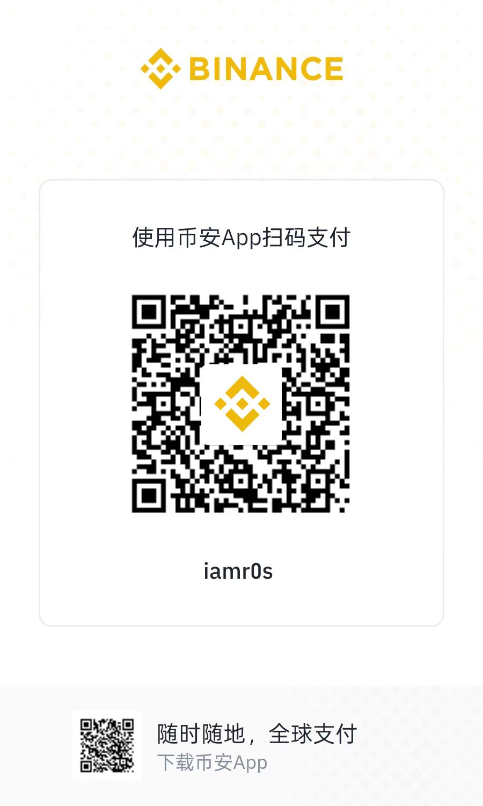

# CarVeX

[中文](README.md) | English

[](https://github.com/iamr0s/carvex-android/actions/workflows/android.yml)
[](LICENSE)

> An Android implementation of multi-protocol vehicle connectivity; CarPlay is the first
> protocol being reproduced from iPhone firmware.
>
> **Status: research preview.** The CarPlay path is the most complete; HiCar, CarLife,
> ICCOA and others are not implemented yet. Local tests and compilation do not prove
> interoperability with a real head unit, and anything without evidence stays `OPEN`.

## Why this exists

The era seems to open wider and close tighter at the same time. Each vendor turns its protocol into a fence and its ecosystem into a rope, claiming openness while enclosing territory; users are lifted high and then discarded when no longer useful.

We want interoperability to return to the protocol itself: not a vendor configuration table, not a lock-in to one ecosystem, but behavior derived from the protocol stack, negotiated fields and capability bits so that phones and head units can connect as broadly as possible.

> “These walls are funny. First you hate 'em, then you get used to 'em. Enough time passes, you get so you depend on them. That's institutionalized.”
>
> — Red, *The Shawshank Redemption*

## Donation

If this project has helped you, you are welcome to donate as a thank-you. Donations are optional and do not constitute any support commitment.

<p align="center">
  
  
  
</p>

<p align="center">Alipay · WeChat Pay · Binance Pay</p>

## What this is

CarVeX is the Android implementation of multi-protocol vehicle connectivity, currently CarPlay-first. The goal is not CarPlay-only: HiCar, CarLife and ICCOA plug into the same session, platform and host framework. The CarPlay chain implemented so far matches the research docsets:

Protocol research, connection analysis and firmware evidence live in the separate repository: [`iamr0s/carvex-carplay-research`](https://github.com/iamr0s/carvex-carplay-research).

```text
Bluetooth RFCOMM
  -> iAP2 link
  -> Identification / Authentication
  -> Wi-Fi handoff
  -> AirPlay control
  -> RTSP SETUP
  -> video / audio / microphone
  -> normal teardown and reconnect
```

The implementation is organized so protocol logic can be tested on the JVM without a
phone, while Android-specific transport stays in platform modules. It also embeds a
CarLife mixing host adapter so the same session can be launched from several vendor
head-unit ecosystems.

The Android side is modular: `:protocol-api` defines protocol contracts,
`:protocol-carplay` implements CarPlay, `:bridge` only orchestrates sessions,
`:platform-android` provides platform capabilities, and `:app` assembles modules and
injects hosts. Adding HiCar, CarLife, ICCOA or another protocol means adding a separate
`:protocol-*` module and wiring it into `:bridge`/`:app`; the CarPlay implementation does
not need to change. `:protocol-carlife` is currently a reserved skeleton. Host and
mirroring integrations use separate `:host-*` modules: Xiaomi CarWith, OPPO CAR+ and
similar ecosystems plug in as host adapters without changing the protocol stack.

This repository can also live inside the larger research workspace at
`D:\carvex-research\android`; in that layout, the workspace rules in the parent
`AGENT.en.md` apply as well.

## Current CarPlay capabilities

- CarWith navigation end notifications discard cached routes, so a later subscription does not replay an ended route. Guidance state, maneuver and lane mappings remain incomplete; see [route cache repair](docs/fixes/2026-11-10-g03-navigation-end.md).

- Resource changes accept combined screen/audio requests within the supported transfer subset. Constraint arbitration and active application states remain incomplete; see [validation record](docs/fixes/2026-11-10-resource-batch.md).
- Active navigation prompts retain a bounded PCM prefix during SETUP and deliver it before live audio. Source stop or failed setup discards the prefix; see [startup buffer limits](docs/fixes/2026-11-10-navigation-startup.md). Vehicle playback remains unverified.

- Cluster album art: host images are sent through the subscribed iAP2 file session. Requires the receiver's file-session capability and artwork subscription; display on a real cluster remains unverified.

- Paired-device list, explicit connect/disconnect, per-device settings and diagnostics.
- iAP2 link establishment, identification flow and control-session routing.
- Wi-Fi handoff and AirPlay control / RTSP setup pipeline.
- Protocol and pipeline modules for video, audio, microphone, RTP timing and
  retransmission; head-unit interoperability still requires vehicle acceptance.
- Experimental cellular-call microphone path: grant phone-state access under Settings →
  Call microphone to negotiate vehicle `telephony` input during cellular activity, decode
  it for the host, and release it on hangup. No numbers are read or recordings saved.
  Actual cellular uplink consumption by the host remains unverified; VoIP is outside this path.
  See the [implementation and validation record](docs/fixes/2026-11-10-call-microphone.md).
- CarLife mixing host for Xiaomi, OPPO, vivo and Samsung; Honor is packaging-only.
- Structured bridge logs with copy and export. Debug and Release both record music, navigation and call host inputs, protocol fields, subscriptions and send outcomes; see the [debug log record](docs/fixes/2026-11-10-business-debug.md).
- Shizuku-assisted read of the phone Bluetooth MAC address, used by the identity
  handshake when the system does not expose it.
- Local mirror pages (connection splash and no-host screen).
- Light/dark/system theme and a permission onboarding flow.

## Connection methods and current limits

The UI exposes three method entries, but the active bridge backs only one today:

| UI method | Bridge status |
|---|---|
| `CarPlay-Bluetooth` | Supported: `ConnectionMode.CARPLAY_BLUETOOTH` |
| `CarPlay-WIFI` | Listed in the UI; no separate bridge mode |
| `CarPlay-USB` | Listed in the UI; no separate bridge mode |

Authentication is experimental. The UI reports that the experimental connection flow
verifies challenge signatures, pairing signatures and encrypted data, but production
certificate-chain trust is **not** established. Treat a successful connection in one
environment as a data point, not as general compatibility.

## Requirements

- Android 10 or newer (`minSdk 29`); `compileSdk` and `targetSdk` are 37.
- A device with Bluetooth; Wi-Fi and local-network permissions for the handoff path.
- Android SDK platform 37 and build-tools 36.0.0.
- JDK 17 or newer for Gradle. CI uses Temurin 17; Android Studio's bundled JBR also works.
- Gradle Wrapper from this repository, Kotlin 2.4.21, AGP 9.4.1.
- A signing keystore, published in this repository. Debug and release intentionally share one key.

Shizuku is optional. It is only used to read the phone's Bluetooth MAC address on systems
that restrict `Settings.Secure.bluetooth_address`.

## Build

1. Point Gradle at your SDK. Create `local.properties` if it is missing:

   ```properties
   sdk.dir=C\:\\Users\\<you>\\AppData\\Local\\Android\\Sdk
   ```

2. Signing material is already published in this repository:
   `.signing/keystore.properties` and `.signing/release.jks`. The build uses them directly.
   Only copy `.signing/keystore.properties.example` if you intentionally replace the key.

   `storeFile` is resolved relative to the repository root; an absolute path also works.
   The build fails at configuration time if the properties file, any of the four values,
   or the keystore itself is missing. This is deliberate: a silently unsigned or
   debug-signed build would fail later for reasons that are harder to diagnose.

3. Compile and run the protocol tests:

   ```powershell
   .\gradlew.bat :protocol-carplay:testDebugUnitTest :app:compileXiaomiDebugKotlin
   ```

4. Build one brand:

   ```powershell
   .\gradlew.bat :app:assembleXiaomiDebug --no-daemon
   ```

5. Build all five brands and the host tests:

   ```powershell
   .\gradlew.bat :host-carlife-mixing:test :app:assembleXiaomiDebug :app:assembleOppoDebug `
     :app:assembleVivoDebug :app:assembleSamsungDebug :app:assembleHonorDebug --no-daemon
   ```

APK output:

```text
app/build/outputs/apk/<brand>/<debug|release>/CarVex_<brand>_<buildType>_<version>.apk
```

`versionCode` and `versionName` are both `20000 + git commit count`, so a build needs real
git history (`git rev-list --count HEAD`). A source archive without `.git` falls back to
`10001` / `local`; do not use that for distribution. Debug and release use the same key,
so installing one replaces the other on the same device.

Release builds enable R8 and resource shrinking. Lint is configured with
`abortOnError = true`, and warnings that fail lint fail the build.

## CI and signing

The workflow at `.github/workflows/android.yml` runs on pushes to `main`, on pull requests
and manually. It runs tests for `:protocol-carplay`, `:pcm-core`, `:host-api`, `:bridge`,
`:host-carlife-mixing` and all five app flavors, then `:app:lintRelease`,
`:app:assembleRelease`, and verifies the produced APKs.

Release signing needs these repository secrets: `ANDROID_KEYSTORE_BASE64`,
`ANDROID_KEYSTORE_PASSWORD`, `ANDROID_KEY_ALIAS` and `ANDROID_KEY_PASSWORD`. Pull requests
from forks cannot read them, so the PR job generates a throwaway keystore only to let the
build configure. Nothing signed by that throwaway key is published.

Every non-PR run publishes the signed APKs and `SHA256SUMS` as a prerelease named
`build-<run>` under GitHub Releases. These are experimental builds: audio, microphone,
video, touch and compatibility still require vehicle acceptance. Call uplink additionally
requires confirmation that the host passes the received audio into the actual call.

This repository intentionally publishes `.signing/keystore.properties` and `release.jks`
for reproducible builds; they are not a security boundary. Do not commit `local.properties`,
device-private logs or real user data.

## Module map

```text
:protocol-carplay    carplay.core primitives + Android CarPlay session
:pcm-core            pure-JVM PCM conversion and resampling
:platform-android    Bluetooth, network, NSD and Surface adapters
:protocol-api        protocol contracts (pure JVM)
:protocol-carlife    CarLife protocol skeleton (reserved)
:host-api            host contract
:core                shared state, events and diagnostics
:bridge              session orchestration; host-agnostic
:host-carlife-mixing CarLife mixing host shared by all brands
:app                 application, UI, services, flavors and host wiring
```

Dependency direction is strictly downward. `:bridge` never depends on a host module; `:app`
injects the host through `SessionController`. `:protocol-carplay` must not depend on
`:app`, `:bridge` or any Koin/Compose setup.

## Adding protocols and hosts

To add HiCar, CarLife, ICCOA or another protocol:

1. Create a new `:protocol-<name>` module implementing the `:protocol-api` contracts.
2. Keep platform differences in `:platform-android` or a new platform module; keep host
   services and permissions in `:host-*`.
3. `:bridge` orchestrates only through contracts; `:app` performs assembly and flavor
   selection.
4. Do not modify the existing `:protocol-carplay` state machine.

To add a mirroring ecosystem such as Xiaomi CarWith or OPPO CAR+, create or extend a
`:host-*` adapter without changing `:protocol-*`. `:protocol-carlife` is currently a
reserved skeleton and must not be presented as a working CarLife connection.

## Brand flavors

Each flavor changes the application ID and selects a host plugin. There is no automatic
fallback to Xiaomi when a flavor is unknown.

| Flavor | Application ID | Host package | Service |
|---|---|---|---|
| `xiaomi` | `com.baidu.carlife.xiaomi` | `com.miui.carlink` | `com.xiaomi.ucar.carlife.CarlifeConnService` |
| `oppo` | `com.baidu.carlife.oppo` | `com.oplus.ocar` | `com.oplus.ocar.connect.carlife.CarlifeCastManagerService` |
| `vivo` | `com.baidu.carlife.vivo` | `com.vivo.car.networking` | `com.vivo.vivo_car_service.CarLifeMixingService` |
| `samsung` | `com.baidu.carlife.samsung` | `com.samsung.android.carlink` | `com.samsung.android.carlink.mixing.CarLifeMixingService` |
| `honor` | `com.baidu.carlife.honor` | `com.hihonor.auto` | No confirmed public mixing endpoint |

The Honor flavor builds for packaging, but its host plugin reports unavailable. "APK
installed" is not evidence that a third-party app can bind the Honor system service.

## Tests

```powershell
.\gradlew.bat :protocol-carplay:testDebugUnitTest
.\gradlew.bat :pcm-core:test :host-api:test :bridge:testDebugUnitTest
.\gradlew.bat :host-carlife-mixing:testDebugUnitTest
.\gradlew.bat :app:testXiaomiDebugUnitTest
```

Tests prove only the checked conditions. They are not a substitute for a head-unit
capture or a field test.

## Status and non-goals

- This repository does not modify head-unit firmware or third-party receiver software.
- No vehicle model is hardcoded; compatibility must follow negotiated fields, not a model
  name.
- Do not close a connection issue based on one successful run.
- State machines are determined by the protocol stack and negotiated fields, not by a
  per-vehicle or configuration-table state machine.
- `CONFIRMED`, `INFERRED` and `OPEN` are kept separate in the research workspace. This
  README only summarizes; it is not a protocol specification.
- Before changing code, read [`AGENT.en.md`](AGENT.en.md) for module, evidence, signing and test
  rules.

## License

GNU General Public License v3.0. See [`LICENSE`](LICENSE).

Not affiliated with Apple, Baidu, or any phone, vehicle or head-unit vendor. CarPlay is a trademark of Apple Inc.

### Music playback state sync

Enable notification access from Music playback sync in Settings. The app observes only the Android media session uniquely matching the host song and reports its playback state to the cluster; notification text is not read. Missing access or ambiguous players leave the state unknown. Audio focus changes are not treated as player state. Steering-wheel toggles select host Play/Pause only from the reported player state at dispatch; unknown state uses Android's native media toggle. Key delivery never predicts the next playback state. Steering wheel behavior still needs vehicle verification.

CarWith's cluster music notification can put a lyric in the song field and the complete song-artist label in the artist field. When a unique media session matches, display and artwork caching use its actual title and artist; playback state still comes from that session. Missing access, incomplete fields or ambiguous players preserve the host's display metadata and leave state unknown. See [lyric display and artwork identity repair](docs/fixes/2026-11-11-cluster-lyrics.md) and [state matching](docs/fixes/2026-11-10-carwith-lyrics-state.md).

Fast-forward and rewind now use Android's standard media keys and preserve physical press, release and disconnect cleanup. Sustained seeking and stopping on release still need verification with the target player; see the [media key repair record](docs/fixes/2026-11-10-g08-media-key-edges.md).
