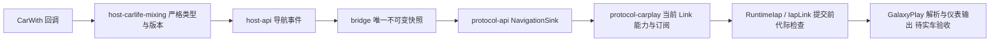

# GalaxyPlay 0.1.212 仪表导航链路修复

日期：2026-11-11。已启用版本已审的 CarWith 基础转向与正数机动距离，通过当前 iAP2 订阅发布 5202/5201。相关本地测试与五个品牌 Kotlin 编译通过；实际仪表显示待验收，未打包或安装 APK。

此前 HUD 仅发布道路和路线剩余距离，缺少有效路线状态及机动定义；重构中删除了这些未证映射，但生产编码暂时全部阻断。本次依据 Apple 原状态/机动表与用户指定的 GalaxyPlay 接收端消费分支，启用数值核心。

## 链路和行为

- 只在 CarWith 4.0.14-20260801 合同下解析 Boolean true/false 和 HUD Int action。HUD 更新不能独立开始或复活结束的路线；其它品牌/版本不复用未审合同。
- navi_turn 来自原图标分类器。已确认的右转、左转、斜向和掉头显式映射 Apple 类型；未知值不生成箭头。只接收严格 Int、正数且未饱和的 remain_distance；零不表示抵达。
- relay 保存唯一快照并复制可变字段，区分 Absent/Value/Clear，清旧路线/车道，双结束幂等。机动代际跨路线递增、距离更新保持稳定；wire 索引用低 16 位，每批都有完整定义与引用。
- 当前认证、Identification、control 可写及 5200/5203 入站、5201/5202 出站声明齐全后，仍需实际 START。无组件 START 不补 ID；STOP 全停当前订阅并撤销未提交项。
- 从 Identification p30/p0/p6 读取每个订阅组件的 ID 和容量；缺失、零、非法或重复声明不能授权机动。不硬编码 GalaxyPlay 样本组件 42 或容量 8，不解读未证文本上限。
- 有效机动先 5202 定义，再 5201 Active、同一 p13 U16 索引与 p10 U32 距离。未知距离先 NotActive reset 再定义/引用；未知转向先 reset 再 Active 无引用，防止旧箭头/距离残留。Ended/Invalidated 仅发 NotActive，保留订阅，不主动发 5203。
- 新 START、STOP、Ended、解绑、Link 失效和快照替换使旧 token 失效。IapLink 在分配序号前检查 token；已提交分片继续既有可靠传输。队列拒绝/部分发送不推进整批成功状态，也不增加盲重发。

## 证据和范围

Apple 原表：CarPlay 0x247b00444/table2690da898 与 0x247b3a190/table2690da6a8；accessoryd 0x100004428/0x1000c5008 为数值转换，0x100003b28/0x1000de30c 为参数映射，0x1000027f4/0x1001777c0 为编码，0x1000c5704 为组件解析。

宿主原 DEX：classes2 0x16fc3c/0x16f3f0 为 HUD/距离，0x1aedb4/0x1af2fc 为图标分类与模板映射；已查看原 APK 模板像素，不能把 OPERATION 或组码直接照抄为 wire 类型。

GalaxyPlay 0.1.212：classes2 0x024858/0x0249f0/0x024070/0x024810 为定义合并、路线引用、快照及 reset；classes3 0x01e3fc/0x01e914 为实际导航组件声明。米数消费及 reset→定义→引用顺序属于此接收端兼容证据，通用 Apple 单位/完整增量顺序继续 OPEN。

完整地址、哈希、字段合同与验证入口见研究仓库 research/connection/spec/navigation-numeric-core-20261111.md 和 galaxyplay-receiver-audit-20261111.md。Android 子模块仍可独立构建；这些外部研究路径不作为编译依赖。

不发布 road_name、total_distance、目的地、ETA、全程距离/机动数量、驾驶侧或 5204 车道；没有可靠生产者或单位/显示合同的字段保持 unknown。当前回调无法区分取消和抵达，也无法完全识别无 routeId/sequence 的跨路线迟到 HUD。

## 验证与实车步骤

host-api、host-carlife-mixing、bridge、protocol-carplay 单测及小米/OPPO/vivo/三星/荣耀 Kotlin 编译通过。测试覆盖版本/类型、映射和零/异常距离、不可变合并、机动代际、真实编码定义/引用/距离、未知清除、结束屏障、订阅/能力、队列拒绝、提交前撤销和已提交分片完整性。完整数量见研究仓库 OpenSpec validation.md。

按匹配提交自行构建安装，保留从宿主绑定、实际 Identification/START 开始的完整日志。逐项验证：开始后首次 HUD、左/右/掉头与距离递减、未知图标或零距离清旧值、结束清屏、结束后重新订阅、STOP→START、导航中断开重连、不同组件容量。分别记录 writer 完成、接收端业务接受和仪表显示；本地 PASS 不能写成实车 PASS。
