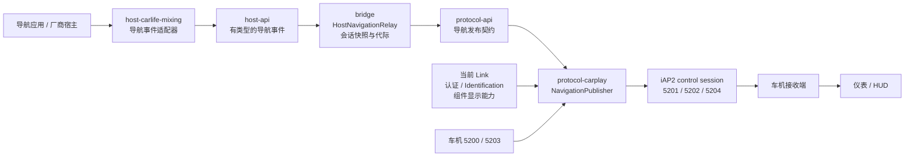

## Context

日期：2026-11-11。状态：已实施导航契约、relay、订阅、数值核心与投递撤销；可选字段和仪表验收仍 OPEN。本文的状态机、缓存和模块接口是 CarVeX 设计；Apple 协议结论仍由原固件证据限定。当前生产编码启用已审 CarWith 基础转向、正数机动距离和 NotActive 终态；通用 Apple 米数/完整更新时序未闭合，兼容消费依据限 GalaxyPlay 0.1.212。详见 [实施记录](../../../android/docs/fixes/2026-11-11-navigation-cluster-chain.md)。

本次规划严格校验通过，原镜像哈希、导航必需表与 6 个限定指令字通过独立读取复核；现有 docset 完整验证因缺切片、哈希不符和依赖缺失而失败。详情见 [检查记录](validation.md)，实施前须按 P0 处理该证据基线问题。

### 当前链路与缺口

修改前的导航路径为宿主 `optionalAction(Intent)` → `SessionController` 的厂商 action 分支 → `NavigationGuidance.RouteUpdate` → `AirSession` → `NavigationPublisher` → runtime iAP2 control session。下表是修改前代码观察；当前实现遵循下文事件与 relay 分层，导航语音另走 AirPlay 音频通道。

已存在的能力：当前 runtime Link 接收 `5200/5203`，检查四项必需消息声明；订阅前缓存最新路线；宿主结束清缓存；纯 Kotlin 编码入口支持路线、机动和车道。缺口是桥接层只接入道路/距离，开始事件仅记日志，机动和车道入口没有宿主调用，且道路/距离映射仍未完全证实。

| 当前实现位置 | 观察到的实现 | 重新规划的处理 |
|---|---|---|
| `SessionController` 导航 Intent 分支 | `road_name → currentRoad`、`remain_distance → distanceRemaining`；action/turn 未映射 | 厂商解析迁入宿主；未知语义不得继续作为已证 wire 字段 |
| `CarLifeNavigationIntent` | 布尔 false、整数 action=3 识别为结束 | 保留严格类型判断，迁入宿主事件生产者，结束双通知幂等 |
| `latestNavigation` 与 publisher 的 `route` | 桥接和协议分别缓存路线对象 | 会话持有唯一规范化快照；publisher 只持订阅与投递状态 |
| `NavigationPublisher.send(5202/5204)` | raw TLV，无机动/车道完整快照回放 | 增加有类型的批次入口，raw TLV 留在协议模块内部 |
| `NavigationGuidance` 全局对象 | bootstrap 状态与纯解析器共存 | runtime 不读全局状态授权；是否删除全局兼容入口另查调用者 |
| 显示限制 | 编码器检查整数宽度/字符串结尾 | 增加 Identification 组件能力到发布器的路径 |

以上是代码观察，不是 Apple 行为证据。代码入口见 [SessionController](../../../android/bridge/src/main/java/io/github/iamr0s/carvex/session/SessionController.kt)、[NavigationPublisher](../../../android/protocol-carplay/src/main/java/io/github/iamr0s/carvex/carplay/core/NavigationPublisher.kt)、[NavigationGuidance](../../../android/protocol-carplay/src/main/java/io/github/iamr0s/carvex/carplay/core/NavigationGuidance.kt)。

### 证据基线

CarPlay 本地基线为 24A446 accessoryd，SHA256 `2b0a2010e6d2605e07d87f05659c932e03de34476a76431196a9bb58da7dc4fe`；身份来自 [源镜像元数据](../../../research/protocol/iap2_input_business_lifecycle/source/metadata/summary.json)，复核使用 [原始二进制](../../../research/protocol/iap2_input_business_lifecycle/source/firmware/accessoryd)。本轮未读取原 IPSW 的 BuildManifest，不新增系统版本结论。

| 证据项 | 已证范围 / 状态 | 原始地址与入口 |
|---|---|---|
| E01 导航消息方向及必需组 | CONFIRMED：车机发 `5200/5203`、手机发 `5201/5202`；`5204` 可选 | `_gskMsgNavigationMainList` `0x1001b40e0`，检查器 `0x100050c2c`；[导航审计](../../../research/protocol/iap2_input_business_lifecycle/analysis/05-navigation-hud.md) |
| E02 START 参数 | CONFIRMED：p0 重复 U16 组件；p1–p5 空值且各至多一次；可无 p0 | `0x1001753c0..0x100175478`、`0x100175508..0x100175530`；[原汇编](../../../research/protocol/iap2_input_business_lifecycle/source/asm/accessoryd/f_10017527c.s) |
| E03 START 能力门及 options | CONFIRMED：必需组检查；单独查询 `5204` 能力；options 的具体业务解释仍 OPEN | `0x100175590..0x1001755f0`；E02 原汇编、[未决表](../../../research/protocol/iap2_input_business_lifecycle/spec/10-open-items.md) |
| E04 STOP 参数 | CONFIRMED：p0 按 U16 解析，坏长度失败；组件表的细粒度停止范围仍需平台消费者 | `0x100175a44..0x100175a88`；[原汇编](../../../research/protocol/iap2_input_business_lifecycle/source/asm/accessoryd/f_10017593c.s) |
| E05 显示能力来源 | CONFIRMED：7 项导航显示能力由 Identification 设置，不来自 START | `0x1000c5704`、`0x1000c5c78..0x1000c5d38`；[补证](../../../research/protocol/iap2_input_business_lifecycle/analysis/11-firmware-open-closures.md) |
| E06 路线状态转换与字段键 | 局部数值边界可读；状态名、完整字段键/单位/消费语义 OPEN | `0x100004428`、`0x100003b28`、机动/车道键入口 `0x1000dd130/140/150`；[状态原汇编](../../../research/protocol/iap2_input_business_lifecycle/source/asm/accessoryd/f_100004428.s)、[键原汇编](../../../research/protocol/iap2_input_business_lifecycle/source/asm/accessoryd/f_100003b28.s) |
| E07 出站消息入口 | 消息入口已定位，逐字段消费者与跨消息引用顺序仍须闭合 | `5201` 发送点 `0x1000027f4`，`5202` `0x1001777c0`，`5204` `0x100177d80`；[导航审计](../../../research/protocol/iap2_input_business_lifecycle/analysis/05-navigation-hud.md) |
| H01 CarWith 生命周期与距离生产者 | 既有 DEX 审计确认 true/false、action=1/2/3、米/公里转换、total_distance 的缓存来源；不等于 Apple 枚举/路线语义 | CarWith 4.0.14 classes2 `0x1c5c20/0x16fb48/0x16fc3c/0x16f3f0/0x16ffc4`；[DEX 审计](../../../research/connection/spec/carwith-4.0.14-host-evidence.md)、[指令哈希](../../../research/connection/evidence/carwith-4.0.14-host.json) |
| V01 既有设备日志 | 有订阅和 `5201` 发送记录；未确认修改后仪表显示 | [2026-11-09 核查](../../../research/connection/spec/cluster-publishing-audit-20261109.md) |

规划阶段只阅读了 H01 既有审计；实施阶段已读取 `CarWith_4.0.14-20260801.apk` 并运行宿主检查器，101 个代码项和距离/语音分支复核通过。外部 UCarMapInfo 生产者与 Apple 映射仍未闭合。公开 Apple 系统集成资料可说明仪表/HUD 使用 iAP2 导航元数据的架构，但不能替代上述字段证据，索引见 [官方资料续查 G03](../../../research/connection/spec/official-followup-20261110.md)。

## Goals / Non-Goals

**Goals:**

- 形成可实施的“宿主数据 → 导航快照 → 当前 Link 订阅 → iAP2 → 车机仪表”链路。
- 同时处理路线状态、机动、车道、结束、重订阅和重连，不再把 HUD 文本更新视为完整导航。
- 每个 wire 字段能够追溯来源、Apple 映射、有效性、显示能力及发送结果。

**Non-Goals:**

- 用户已授权实施代码；本次不打包、不安装、不提交或推送仓库。
- 不改车机固件；车机收到元数据后如何通过车内总线驱动仪表归接收端，当前没有可实现的通用车机→仪表私有协议。
- 不加入仪表地图视频流、CarPlay Ultra、路面目标检测 `0D00/0D01/0D02` 或导航应用 OCR；这些有独立证据和能力要求。
- 导航语音提示生命周期与资源仲裁维持独立研究范围；提示播放、提示结束、屏幕切换都不能作为路线开始/结束的证据。

## Decisions

### 1. 按职责划分链路

`:host-api` 拥有协议无关的导航事件类型；`:protocol-api` 提供协议无关的导航发布输入/端口，不依赖 host 包；`:bridge` 显式转换二者。`:host-carlife-mixing` 只解释宿主协议，`:protocol-carplay` 只解释 CarPlay/iAP2。沿用已有依赖方向，`:app` 完成注入，库模块不引入 Compose/Koin。

先核实现有接口可扩展点，再选择最小接口改动；不为了规划新增一个平行会话框架。`SessionController` 调用 relay 与协议端口，不直接识别厂商 action 或组装 `520x` TLV。

### 2. 使用导航事件和唯一会话快照

拟定事件：`Started`、`Updated`、`Rerouting`、`Ended`、`SourceInvalidated`。来源没有已证重算事件时不能产生 `Rerouting`；结束原因没有证据时为 unknown，不能默认抵达。

拟定快照包括：

| 类别 | 内容 | 约束 |
|---|---|---|
| 身份 | sourceId、hostBindingEpoch、routeEpoch、revision、接收时序 | 本地标识不进入 wire；若来源提供可靠 routeId/sequence 则一并保留 |
| 生命周期 | unknown/inactive/active/rerouting/ended，结束原因 | 本地语义枚举；不能按 ordinal 编码为 Apple 状态 |
| 路线概览 | 当前道路、目的地、剩余时间、剩余路线距离、预计到达 | 各字段独立有效，时间基准和单位必须明确 |
| 当前机动 | 稳定机动身份、索引、类型、描述、转向后道路、机动距离 | 索引来源和引用必须一起核实；不能每个距离样本都产生新机动 |
| 车道 | 车道组身份、索引、方向、推荐信息 | 没有来源时为 unknown；不能由转向图标虚构车道 |
| 来源证据 | 宿主版本、字段映射证据项、有效/缺失/清除/未确认 | unknown、合法零和显式 clear 区分 |

`HostNavigationRelay` 通过单一串行入口合并不可变增量。更新区分 `Absent`、`Value`、`Clear`：字段未出现不清旧值，新路线或机动替换则清其从属数据，避免把上一转向的车道并入下一转向。复制列表/图片等可变输入，回调返回后不可被宿主修改。

双结束通知只结束当前 routeEpoch 一次；新路线创建新代际；所有本地异步工作携带创建时的代际并在应用结果时复查。**本地代际不能识别已经在上游乱序、却刚进入回调的旧 HUD**。没有来源 routeId/sequence 时，Ended 后的普通 Updated 不得自行重新激活路线，需要已证的新 Started；新 Started 后上游迟到样本的歧义继续登记为 OPEN，不用固定延时猜测。

会话 relay 是唯一规范化数据缓存。publisher 缓存订阅、已编码投递状态和指向不可变快照的引用，重新 START 时从 relay 取得当前快照，不维护第二套可独立变化的路线内容。

### 3. 对宿主字段作明确的映射准入

| 宿主输入 | 新模型 | CarPlay 目标 / 准入结论 |
|---|---|---|
| `isNavi` 严格 Boolean | Started/Ended | Apple active/ended 的 `5201` state 必须另证；不能照抄 true/false |
| HUD `action=1/2/3` 严格整数 | 首次提示/提示更新/结束，结合宿主生命周期归类 | 不是 iAP guidanceState；action=1 是否可独立开启路线须查生产者门 |
| `road_name` | 未完全定性的机动道路文本 | 不直接当 `currentRoad`；闭合 WHERE 生产者后再决定 currentRoad/afterRoad/description |
| `remain_distance` | observedDistanceMeters，语义待证 | 不直接当路线剩余距离；闭合阶段语义后映射到 route/maneuver 距离 |
| `total_distance` | 机动提示缓存距离，保留来源记录 | 不映射整条路线长度；也不能据此构造 ETA |
| `navi_turn` / `OPERATION` | 原值 + 版本 + 未确认的机动候选 | 逐枚举双向取证，再映射 `5202` type；无证值不发 |
| `turn_icon_data` | 原始图标数据，仅作诊断索引 | 不充当机动 type，也不走 Now Playing 封面文件会话 |
| 缺失目的地/ETA/车道 | unknown | 不填默认目的地、固定时间或伪造车道 |

即使宿主转换函数返回 0，也可能是“现在”、无法识别单位或异常；没有原距离/单位或等价有效性来源时，0 不能证明抵达，也不能升级为可靠机动距离。其他品牌分别验证，不将 CarWith action 合同套到 OPPO/vivo/三星。

### 4. Link、订阅、路线分别管理

允许发包的逻辑条件为：当前 control session 可写，认证/识别达到协议要求，当前车机必需消息组齐全，有效 `5200` 订阅，目标消息在车机接收声明中，字段证据和组件能力通过，发送项的 Link/订阅/路线代际仍有效。

消息方向用 `accessorySends` / `accessoryReceives`，避免不明确的 sends/receives；`5204` 缺失不阻断 `5201/5202`。认证/识别的具体状态判断复用实际 RuntimeIap 状态，不用视频 SETUP 成功设置导航 ready。

| 事件 | 订阅处理 | 会话路线处理 | 发送处理 |
|---|---|---|---|
| 宿主 Started/Updated，尚无 START | 不产生订阅 | 合并当前有效快照 | 不发送，只等待真实订阅 |
| 有效 `5200` | 原子替换组件与 options，递增 subscriptionEpoch | 从 relay 读取当前路线 | 按新组件能力重编码；可发布的终态按已证终态规则处理 |
| 无 p0 的有效 START | 保留空组件语义 | 不改路线 | 不补默认仪表组件；具体适用 profile 未证则阻断相应发布并记录 |
| 非法 START/STOP | 保持原订阅及 epoch | 不改路线 | 不把坏包当清理事件 |
| 有效 `5203` | 清当前订阅，递增 epoch | 同一宿主来源的路线可继续存在 | 撤销尚未交给 writer 的旧导航项，三类消息均停止 |
| 宿主 Ended | 保留车机订阅 | 清路线/机动/车道，保留最小终态记录用于去重 | 已证时发布终态 `5201`；未证时只清本地数据并记 wire-terminal-unverified |
| Link 失效 / reconnect | 清订阅、组件能力、投递基线 | 同一会话来源快照只在来源仍有效时保留 | 旧 Link 项失效；新 Link 完成门控和 START 后重新编码 |
| 宿主解绑 / 会话结束 | 清会话关联订阅与投递状态 | 清所有快照、终态及本地异步任务 | 所有旧 binding/session 项失效 |

STOP 携带组件列表的精确平台作用范围未闭合；第一阶段沿用停止整个当前导航订阅的保守策略，不自行新增“只停一个组件、其他组件继续发”的行为。已写入 socket 的字节不能撤回，日志记录 writer 边界，不能承诺 STOP 时远端已经清屏。

### 5. 以完整快照构建路线、机动和车道批次

| 消息 | 目标内容 | 实施前证据任务 |
|---|---|---|
| `5201` | 路线状态、路线概览、当前机动距离、机动索引/数量、车道索引、按 options 允许的来源/时间/结束信息 | E06/E07：键表、宽度、单位、状态转换、逐字段 options 门和消费者 |
| `5202` | 可引用的机动描述、类型、道路、距离和已证辅助字段 | E07 + H01：机动索引、转向枚举、距离语义和有效性 |
| `5204` | 可引用的车道组、方向和推荐信息 | E07：嵌套 TLV 与索引；另找宿主车道生产者；要求接收声明 |

现有 `NavigationGuidance.RouteUpdate/ManeuverUpdate/LaneUpdate` 是待审计编码器，不因 Kotlin 类型已存在就认定每个字段已证。尤其状态转换 `0x100004428` 的 `<7` 数值分支不足以推导每个状态名。

publisher 接收 `NavigationSnapshot`，转换成一个携带同一 revision、routeEpoch 和 subscriptionEpoch 的发布批次。路线引用、机动定义、车道定义必须属于同一快照；容量选择后再计算索引和数量，不能发出悬空引用。无法证明重复字段的“空集合清除”编码时，不伪造空 TLV。

首个快照、重新订阅、重连、新路线都需要完整的可发布状态；距离变化只更新已证允许增量的字段；机动变化更新机动定义和对应路线引用。`5201/5202/5204` 的具体发送先后必须由固件调用链或匹配抓包闭合后固定，不把“机动先于引用”作为未经证实的 Apple 要求。

批次只保证本地同一快照和串行 writer 顺序，不声称多个 wire 消息能原子抵达。`emit=false` 或中途失败不能推进整个批次的已交付基线。后续真实更新/新 START 可触发重新投递，禁止新增导航固定延时或无条件重发；iAP2 链路重传仍由传输层负责。

### 6. 从 Identification 限制每个显示组件

将导航显示组件的当前道路名、目的地名、转向后道路名、机动描述、机动容量、车道描述和车道容量连同证据状态传给 publisher。对每个订阅组件分别检查；不同能力的组件按已证重复组件语义分组或分别编码，不能用第一组件的限制覆盖全部组件。

长度单位（UTF-8 字节/字符/其他）、终止 NUL 是否计入、零值和缺失值含义都要先核实。已证允许截断时按正确编码边界截断；未证时省略不合规字段并记录原因，必需字段不成立则阻断相应消息。不能把缺失能力解释成无限、不能裁断 UTF-8 中间字节或截断整个 TLV 包。

### 7. 诊断关联到每一次实际发送

每个事件和批次记录 sessionId、hostBindingEpoch、routeEpoch、revision、linkEpoch、subscriptionEpoch、组件、options、消息 ID、字段 ID、映射证据项和阻断原因。诊断兼容当前日志系统和脱敏方式，不引入新设备私有数据入库。

投递状态区分 `host-received → normalized → planned → queued → writer-sent`，传输 ACK 与“车机业务接受/仪表已显示”独立记录。队列拒绝、旧代际撤销、能力缺失、未知单位/枚举、无订阅均有具体原因。真实显示只能用匹配构建/会话的接收端或实车证据证明。

## Risks / Trade-offs

- [移除历史未证映射后短期显示字段减少] → 迁移说明列出字段变化，先完成 P0 映射审计；不保留按车型开关或隐性旧字段回退。
- [来源缺 routeId/sequence，跨路线迟到 HUD 不能精确归属] → 隔离本地任务代际，结束后禁止普通更新重新激活；将上游歧义单独登记并继续追源。
- [文字/容量单位不明] → 未闭合字段暂不发布，其他独立已证字段可继续；不猜容量上限。
- [宿主结束后仪表仍保留旧箭头] → 在上线终态功能前闭合 Apple state/stopType 及接收端行为；仅清缓存不报告远端清屏成功。
- [多消息批次中途失败] → 单 writer 串行、标记已发送部分、重建投递基线；不声称跨消息原子性。
- [多模块契约迁移影响其他宿主] → 所有宿主编译与相关测试；未知品牌能力明确 unknown，不默认复用小米语义。

## Migration Plan

| 阶段 | 交付 | 完成条件 |
|---|---|---|
| P0 证据与字段合同 | Apple 键/单位/枚举/options/显示限制表；宿主生命周期/距离/道路/turn 表 | 每个启用字段具备原始证据链；未闭合项带地址、缺口和关闭条件 |
| P1 导航契约与 relay | 宿主事件生产者、会话唯一快照、协议无关端口 | 开始/更新/双结束、增量、路线替换、代际与未知值测试通过 |
| P2 路线与机动 | 新 publisher、能力路径、`5201/5202` 批次 | 只发已证字段，真实 START 授权，引用一致，失败/STOP/重连测试通过 |
| P3 可选车道 | `5204` 快照、容量和嵌套编码 | 独立宿主车道来源及 Apple 编码已证；无能力时核心导航可用 |
| P4 实车验收 | 可追溯构建与一次一个假设的测试记录 | 开始、转向、距离、重算、取消、抵达、重订阅/重连分别有结果 |

P0 某个可选字段未闭合不阻塞其他已证字段，但不能把对应功能标为完成。实施前按 AGENT.md 检查各仓库状态、备份将修改文件；每阶段完成相应模块测试和编译。用户自行打包/安装，除非另行明确授权。

回退使用对应阶段的可追溯提交恢复接口与实现，不自动回滚用户改动；旧的未证字段映射不能作为“兼容性恢复”重新上线。文档保留真实结果与仍未闭合的项。

## Open Questions

| 项目 | 缺什么 / 下一步 | 影响 |
|---|---|---|
| `OPEN-NAV-2` | START options 平台解释与逐字段门；追 E03 的平台消费者 | 可选来源/时间/结束字段 |
| `OPEN-NAV-4` | 完整键表和状态/单位/机动枚举；追 E06/E07 原函数、数据常量及消费者 | 完整路线与转向编码 |
| `OPEN-NAV-5` | 更新门、初始状态、机动/车道引用和跨消息顺序 | 首报/增量/重订阅批次 |
| STOP 组件范围 | `0x1000dc880` 后的平台组件停止路径 | 多组件细粒度订阅；当前先全停 |
| HUD 来源语义 | UCarMapInfo 的 WHERE/DISTANCE/OPERATION 外部生产者，来源有效性与 routeId/sequence | 道路、机动距离、转向及迟到事件 |
| 终态 | Apple ended/cancelled/arrived 的状态值、必要字段及消费效果 | 手机导航结束时清仪表 |
| 显示能力单位 | Identification 七项字段的零/缺失、字符计数与 NUL 规则 | 文本和集合边界 |
| 车道来源 | 当前 mixing 公共回调是否实际提供车道，必要时追对应品牌原实现 | P3，不阻塞已证路线/机动 |
| 仪表接收与显示 | 匹配版本/会话的接收端日志或实车记录 | 互通仍 OPEN；本地测试不能替代 |

目标检测 `OPEN-NAV-3` 属于独立消息组，不作为本次路线/机动规划的前置条件。本文不关闭任何已有协议或实车 OPEN 项。

## GalaxyPlay 核查后的数值核心实施

用户授权按 0.1.212 核查修复后，采用 5202 定义→5201 Active/引用/正距离的自包含批次。未知距离先 NotActive reset 再定义/引用；未知转向 reset 后 Active 无伪造引用。Ended/Invalidated 发 NotActive，保留订阅，不伪装抵达。机动代际跨路线递增，低 16 位为 wire 索引；每次更新都带对应定义，距离更新不变索引，回绕仍覆盖定义/明确距离。

每个实际 START 组件从 Identification p30/p0/p6 验证唯一合法正容量；文本、驾驶侧、道路、全程距离/数量、ETA 和车道全部省略。容量/字段不是按车型配置。Apple 原状态/类型/参数键与宽度已闭合；米数与清除顺序按 GalaxyPlay 原消费者作为兼容证据。原设计关于所有 Apple 顺序/单位和可选字段的目标仍保留。

详细证据、参数合同和 OPEN 关闭条件见[数值核心核查](../../../research/connection/spec/navigation-numeric-core-20261111.md)。没有供应商代码执行或实车测试。
