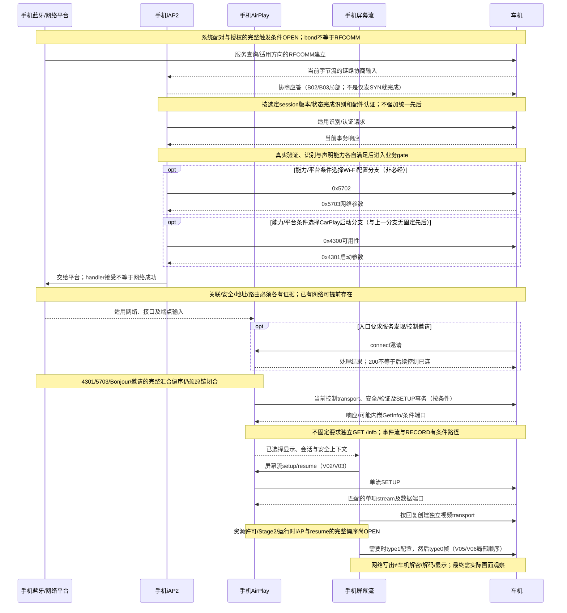

# 01 — 无线连接总图、状态机与阶段验收

本章把 24A446 手机端静态证据和当前文档的未知项放在一张图里。图是 `LOCAL_DESIGN` 的诊断索引，不是恢复完成的苹果原生状态机。原代码存在的局部依赖与未闭合跨模块关系必须分别读，不能把示意上下顺序当成所有车机固定包序。

## 1. 端到端图

```text
候选车机 / 已保存身份
        │
        ├─ 蓝牙发现、配对、RFCOMM                     [B01]
        │        │
        │        └─ iAP2 link connected → {identification, accessory auth}
        │                                                    [B02–B11]
        │
        ├─ 0x5702/0x5703 Wi-Fi Sharing（只给网络参数）   [B12–B16]
        │        │
        │        └─ 操作系统关联成功、地址/路由/接口就绪       [OPEN]
        │
        └─ 0x4300可用性 / 0x4301启动（后者可携带端点、身份及网络字段） [B12/B14]
                 │
                 └─ 端点选择/Bonjour 控制邀请（两路融合关系 OPEN）
                              │
                              └─ AirPlay 控制 TCP 成功
                                      │
                                      ├─ pairing / verification / 独立 auth（按能力条件分支）
                                      │       [AP-08–AP-11]
                                      │
                                      ├─ 控制 SETUP + 可选/内嵌 GetInfo
                                      │       [AP-12–AP-14, AP-19–AP-20]
                                      │
                                      ├─ 事件通道（eventPort 非零时）/保活（可选）
                                      │       [AP-14–AP-15]
                                      │
                                      ├─ 屏幕 stream SETUP → NetworkPortData/数据 transport
                                      │       [AP-21, V01–V04]
                                      │
                                      ├─ RECORD（仅满足启动条件时）/Started
                                      │       [AP-16]
                                      │
                                      └─ 编码配置/关键帧 → 车机接收、解密、解码、实际显示
                                              [V05–V08；接收侧证据 OPEN]
```

已证实的字段及条件关系：`0x5703` 不含 AirPlay IP/port；`0x4301` 可携带端点及网络字段；不能把二者强行画成“首次连接先 5703、重连先 4301”。这些事实本身不证明两个事务一定并行。识别与认证的先后由所选session版本/状态决定，不能用本图强制识别总在认证前。手机也可能在 SETUP 响应或 verification 中处理 GetInfo，而不是每次独立 GET `/info`。[B06–B16、AP-11/12/19]

### 1.1 有界时序图

下图展示参与者与承载，**只在证据明确的局部建立顺序**。两个网络消息分支以及信息/安全事务之间不推断全局顺序；同一个跨版本抓包不能补齐所有未知箭头。



## 2. 连接状态机

```text
IDLE
 │ 发现/选择候选
 ▼
TARGET_SELECTED ──身份失效/取消──► CLEANUP
 │
 ├─ 无线承载失败 ─► RETRY_OR_CLEANUP
 ├─ RFCOMM 成功
 ▼
IAP2_LINK
 │ 识别/认证/业务准入未完成 ─► RETRY_OR_CLEANUP
 ▼
IAP2_READY
 │
 ├─ Wi-Fi Sharing 参数交换（可选/条件） ─► NETWORK_WAIT
 ├─ CarPlay 4301 给出端点 ────────────┘
 └─ 既有网络上的控制发现/邀请 ─────────┘
                                      ▼
NETWORK_READY
 │ 地址族、scope、路由、端口及身份候选可用
 ▼
AIRPLAY_CONTROL_CONNECTED
 │ pairing/auth 分支失败 ─► CLEANUP
 ▼
AIRPLAY_AUTHENTICATED
 │ SETUP/信息响应错误 ─► CLEANUP
 ▼
CONTROL_SETUP_ACCEPTED
 │ eventPort 非零时事件连接失败 ─► CLEANUP（是否可降级需车机证据）
 ▼
EVENT_READY_OR_NO_EVENT
 │ 无可用 displays/流能力 ─► AUDIO_OR_CONTROL_ONLY（不满足本阶段目标）
 ▼
VIDEO_STREAM_SETUP
 │ stream/type/端口/数据 transport 错误 ─► CLEANUP
 ▼
VIDEO_TRANSPORT_READY
 │ 开始条件满足 ─► RECORD_IF_REQUIRED
 ▼
VIDEO_RUNNING
 │ 首帧/持续显示尚未证实 ─► DISPLAY_ACCEPTANCE_PENDING
 │ 断开/取消/超时 ─────────► CLEANUP
 ▼
DISPLAY_ACCEPTED_AND_UPDATING
```

`AIRPLAY_CONTROL_CONNECTED` 不等于 `AIRPLAY_AUTHENTICATED`；`CONTROL_SETUP_ACCEPTED` 不等于 `VIDEO_TRANSPORT_READY`；`VIDEO_RUNNING` 也不等于车机已解码显示。状态名是本文诊断标签，不是苹果公开枚举。

此图的`IAP2_READY`是本项目业务检查点，不允许用一个true替代各层独立证据；`AIRPLAY_AUTHENTICATED`也仅是对本次选定安全路径的合并显示。实际要分别保存配对、证书/签名、身份绑定与key context，不能因noPair返回成功就认为全部认证完成。

### 2.1 与全套文档统一的G检查点

| 编号 | 独立事实 | 在上图的位置 |
|---|---|---|
| G1 | 首次配对/授权或既存状态分别核实 | TARGET_SELECTED之前/期间；不是当前App自动实现首次配对的证明 |
| G2 | 选定RFCOMM字节流可用 | RFCOMM成功 |
| G3 | 当前link与控制session协商有效 | IAP2_LINK |
| G4 | 识别、配件认证、声明能力与业务门槛 | IAP2_READY |
| G5 | 本路径所需网络/启动输入 | NETWORK_WAIT入口；可能预存/异步 |
| G6 | OS关联、安全、地址与路由 | NETWORK_READY |
| G7 | 本路径端点、发现或邀请与身份匹配 | 控制connect前；完整融合顺序OPEN |
| G8 | 当前控制安全、能力/SETUP、条件事件流有效 | EVENT_READY_OR_NO_EVENT；仍非视频成功 |
| G9 | 视频流回复校验及数据transport | VIDEO_TRANSPORT_READY |
| G10 | 配置和帧实际写出 | VIDEO_RUNNING发送侧检查点 |
| G11 | 本次画面在车机实际显示 | DISPLAY_ACCEPTANCE_PENDING之后 |
| G12 | 持续更新及独立新attempt重连通过 | DISPLAY_ACCEPTED_AND_UPDATING加重连样本 |

G编号用于定位，不意味着调度上严格串行。特别是重连必须跨旧、新两个attempt核对清理与恢复；不能要求所有重连证据属于同一个attempt，也不能复用旧attempt的成功位。

任何阶段失败/取消均进入清理，记录旧socket、生产者、定时器和回调是否停止；清理后新attempt重评配对/凭据/端点与临时session，非一律删持久身份。具体原生重试次数、全出口和保护机制尚未全部恢复。

## 3. 阶段验收表

|阶段|最小成功证据|不足以证明成功的观察|下一步依赖|
|---|---|---|---|
|蓝牙/RFCOMM|服务记录解析出当前通道且 RFCOMM 字节流已连接|蓝牙 bond、设备名、HFP 连接|iAP2 链路握手|
|iAP2|链路 connected、识别状态与认证状态分别达到要求，业务消息准入通过|只看到 SYN 或 LinkConnected|0x4301/0x5703 业务入口及网络就绪|
|Wi-Fi|关联成功、目标接口地址/路由/地址族 scope 可达|收到 5703、系统“正在连接”|控制端点可达|
|AirPlay 控制|TCP 连接、RTSP 请求响应、所选安全分支和身份绑定均可关联|端口 connect、单个 HTTP 200|控制 SETUP|
|控制 SETUP|plist 响应可解析，字段消费成功，事件通道按条件建立|SETUP 200、手机只记录发包|屏幕流 SETUP|
|屏幕流|响应 `streams` 数组符合调用契约，NetworkPortData/data transport 建立|手机编码器已启动|开始会话与数据写入|
|首帧|车机实际出现本次测试的唯一可辨画面，并可关联到本次会话和时间；接收/解密/解码另行取证，不可见层仍标未观察|发送计数增加、Started、socket write 成功|持续更新和重连|
|持续显示/重连|画面持续更新；断开后旧资源停止并取得新会话的同层证据|一次成功、旧 session 仍有日志|下一次测试矩阵|

## 4. 每次现场记录的关联键

至少记录：`attempt-id`、测试类型（首次/已配对重连/异常重连）、session generation、iAP2 link、接口、地址族及 IPv6 scope、蓝牙目标、车机 device ID、控制端点、AirPlay session URL、方法/路径/CSeq、方向、状态、耗时、最后成功状态、下一预期状态。

凭据、证书、挑战、密钥和完整设备身份不进入普通日志；只记长度、校验结果或受控脱敏标识。若车机只显示“蓝牙/iAP2/AirPlay”，必须把这个标签映射成“最后成功事件→下一预期事件→缺失/拒绝/断开”，不能直接当根因。

## 5. 本图未闭合的项目

- 4301 端点与 5703 网络配置在平台层的完整融合、消息前后关系和首次/重连差异；[21](21-endpoint-fusion.md) 只关闭局部交接/汇合，不证明端点角色和身份全链。
- iAP2 各承载/profile 的完整 SYN 字段约束、运行时超时和业务消息要求；[11](11-iap2-state-machine.md) 已补 Detection 长度、局部状态表与计时器归属。
- AirPlay pairing/auth 的当前车机实际路线及完整密码学线格式。
- Info/SETUP/RECORD 在目标车机上的实际偏序；尤其 `skipRecord`、eventPort=0 和内嵌 info。
- 车机接收、解密、解码、显示和断线清理证据。

上述项目必须分别以原函数、指定版本抓包、两端运行日志或实车显示证据关闭；不能用当前 Android 发送日志补齐。
