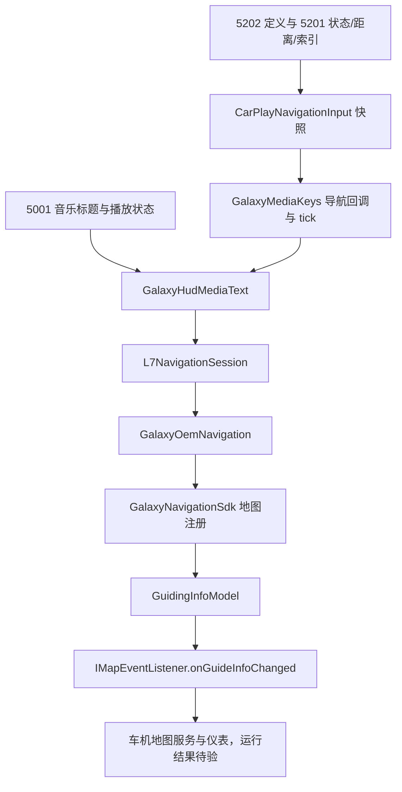

# 日志 6、原厂手车互联与 GalaxyPlay 仪表信息流

日期：2026-11-11。本轮核查用户提供的两份原始车机 APK 和手机日志 6；发送端基线为 Android `fa3000f`，新增宿主来源与 relay 诊断。原始 APK、完整供应商反汇编和设备私有日志保留本地，入库仅包含允许公开的数字、枚举、时间和哈希。

## 结论与证据范围

1. 日志 6 已有当前 Link 的 `5200` 订阅和完整 `5202` 定义→`5201` 状态/距离/索引发送。四组机动均为类型 1、索引 1、245 米。用户随后确认 245 米已显示，但全程剩余里程显示 -1 米，高德地图实际剩余约 19 公里；机动距离达到该次显示观察，全程距离仍 FAIL，其他导航验收保持 OPEN。
2. GalaxyPlay 的 OEM 导航最终使用 `MapAPI.registerMapClient`、`IMapEventListener.onGuideInfoChanged` 和 `GuidingInfoModel`。音乐的 media session/媒体中心入口独立存在；它另有一个可选的 HUD 音乐文字功能，会在导航输出前替换导航快照。代码路径已确认，测试时的设置值和实际执行仍 OPEN。
3. 原厂 `com.geely.linkhmi` 的 Java 导航状态回调主要更新导航活动标记并请求取消本机导航，所审方法没有将箭头/距离交给地图引导接口。SDK 中存在地图注册、Binder 与模型编组路径，不足以说明该 APK 实际如何完成所有仪表输出。JNI 库 `libovmsink.so` 的归属已核，完整导航出口及车机系统服务内部仍 OPEN。
4. 新诊断仅观察现有输入和快照：记录类型、数值、文字/图标的长度与 SHA256，以及快照是否变化、机动代际和生命周期。导航编码、订阅、音乐和发送节奏沿用原实现。

CONFIRMED 在本文指匹配原 APK 指令/字节或日志的局部事实；接收端实现不能替代 Apple 发送端协议依据。下文明确区分静态路径、手机传输记录和仪表现场结果。

## 输入身份与重现

| 输入 | 已核身份 | SHA256 |
|---|---|---|
| GalaxyPlay 原 APK | `com.shilapi.galaxyplay`，0.1.212 / 240，23,629,025 bytes，18 个 DEX | `f106680faa27be5a9dfc4a9a9b9cb59239e4512c5f3b73b64cebfec47bb023e6` |
| 原厂手车互联 APK | `com.geely.linkhmi`，1.0.20260610G(48) / 72，36,651,564 bytes，3 个 DEX | `043866ed5e719fd1617ef57f4060c0fd7030e02df70433c5f5d0f518bf1946af` |
| 设备日志 6 | Release 20028，578,277 bytes，4,416 行 | `6ec5f8c173da36f2640142a9975e7595f86da9867e30b683936a4377a14c6061` |

包身份用 Android SDK 36.0.0 `aapt dump badging` 读取。Windows 版 aapt 无法打开含中文的输入路径，原厂文件使用本地 ASCII 路径副本；副本与原件 SHA256 相同。文件名中的 `(48)` 不是 manifest 的 versionCode，实际 versionCode 为 72。

日志头绑定到 Release 20028。仓库规则 `20000 + 提交数` 下，历史 `9c866b3` 有 28 次提交，因而是对应候选；日志没有提交哈希，不能排除当时存在未提交修改，不能宣称精确源码身份已证明。当前新增诊断基于 `fa3000f`，不属于日志 6 的实车构建。

[证据 JSON](../evidence/cluster-navigation-flow-20261111.json) 绑定两份 APK、manifest、原生库、41 处 DEX 方法归属/签名/指令哈希及脱敏日志。只读重现：

```powershell
python -X utf8 -B research/connection/tools/inspect_cluster_navigation_flow.py `
  --galaxyplay D:/home/GalaxyPlay.apk `
  --factory local-backups/2026-11-11-yilian-cluster-flow/yilian.apk `
  --log "D:/home/device-log (6).txt"
python -X utf8 -B -m unittest discover -s research/connection/tools `
  -p test_inspect_cluster_navigation_flow.py -v
```

验证器按 `field=` 参数编号取值，`index=` 仅表示字段排列位置；严格匹配消息、参数名、会话与事务，排除道路/目的地/联系人文字。初稿曾把排列位置当作参数编号，导致遗漏 p10/p3，并把 p13 误记成 p3；本轮修正并重新生成 schema 2，旧稿保留于本地备份。它同时改为识别实际 `event=subscription id=5200 accepted=true`，不再查询日志中不存在的 `event=start`。

## 日志 6 的导航与音乐时序

以下时间为日志 UTC，上海时间加 8 小时。活动会话 `549f0b99`：

| UTC | 行 | 观察 |
|---|---|---|
| 05:43:17.808 | 975 | 音乐 `5001` 首个已记录传输完成 |
| 05:43:17.814–17.815 | 997–1002 | runtime 接收 `5200`：组件 42，p1/p2 空标记；接受后 link=4、subscription=5；此时阻断原因为 `no-snapshot` |
| 05:44:20.281–20.290 | 2427–2435 | relay revision=1、ACTIVE；先发 `5201` p1=0 reset，再发 p1=1 active |
| 05:44:21.692–21.710 | 2516–2527 | revision=2；`5202` p1=1、p3=1，随后 `5201` p1=1、p10=245、p13=1 |
| 05:44:21.808–21.832 | 2540–2555 | revision=3；同一机动/距离再次发送 |
| 05:45:04.585–04.588 | 3661–3672 | revision=4；仍为类型 1、索引 1、245 米 |
| 05:45:14.028–14.034 | 3790–3801 | revision=5；仍为相同机动/距离 |
| 05:45:58.420 | 4388 | 活动会话最后一个已记录完成的音乐 `5001` |

该会话共 5 次 ACTIVE 快照、10 个 `5201/5202` 报文，均记录 `transport_completed=true`；音乐完成记录为 143 条。另一会话 `30059791` 只有一条音乐完成记录，无该片段中的导航报文。组件 42 仅为实际协商样本，不是手机硬编码值。

revision 2–5 均记录 `road_name-role` 未验证，未发送道路字段，也没有 ENDED 快照。日志没有新增的原始类型/内容摘要，因此无法区分“宿主原始输入未变”和“有字段变化但归一化结果相同”。没有终态记录只能说明本日志缺少该观察，不能认定用户没有结束导航或已经证明终态错误。音乐持续传输不证明仪表如何选择文字来源。

## GalaxyPlay：接收快照到 OEM 输出

沿用[接收端数值核心](navigation-numeric-core-20261111.md)和[原始审计](galaxyplay-receiver-audit-20261111.md)，本轮补齐 classes4 的实际使用者：



- `GalaxyMediaKeys.attach$lambda$5` code_item `0x0fbd6c`：核对当前 controller，取得导航对象，经 `GalaxyHudMediaText.select` 后调用 `L7NavigationSession.update`。`startNavigation` `0x0fd170` 创建这些对象。`startNavigation$lambda$34` `0x0fba60` 以当前 controller 的 `hasActiveSession` 为门，不以音乐主音频流是否正在运行为导航授权。
- `startNavigation$3.run` `0x0fb290` 取导航快照，经同一 select→update 路径，当前对象仍有效时安排下一次 1000 ms tick。这是接收端本地刷新，不能作为手机固定延迟或周期重发依据。
- `L7NavigationSession.update` `0x16a6dc` 与 `publish` `0x16a49c` 管理初始化、ready、start/stop 和 guidance。调用返回、ready 与实际画面是不同检查层次。
- `GalaxyOemNavigation.register` `0x1087e8` 接入 backend 注册结果。`guidance` `0x1086a4` 保存当前值；`flush` `0x1083d0` 要求 registered、listeners 非空及当前 owns 条件，active 时发送本地地图状态 16，再调用各 listener 的 guidance。`stage=guidance result=CALL_RETURNED` 表示调用返回，不能解释为仪表绘制确认。
- `GalaxyNavigationSdk.register` `0x1054b4` 调用反射取得的 `MapAPI.registerMapClient`，提交本包注册信息与客户端数组，读取返回模型的 mapVendor；显式错误模型、错误返回类型、空 api 和身份检查失败均有独立分支。
- 注册回调 `register$lambda$4` `0x1057a0` 处理 `setMapEventListener` 与 `invokeMapAPI`。实际 listener 的 `guidance` `0x105330` 检查 valid/revision，构造模型后调用反射取得的 `onGuideInfoChanged`；`status` `0x1053e8` 是另一回调。
- `GalaxyNavigationContract.<init>` `0x1034d0` 解析 `com.ecarx.eas.framework.sdk.navi.MapAPI`、`IMapClient`、`IBaseMapClient`、`MapClientInfo`、`GuidingInfoModel` 与 `IMapEventListener`，核对注册、状态、引导、成功/失败接口与所需 setter。只看到同名类不能代替这些运行检查。
- `model` `0x102f44` 将机动经 `GalaxyNavigationIcons.fromCarPlay` `0x103f04` 转为 `TurnIconId`；机动段距离进入 `NextTurnDistance`，路线剩余距离进入 `RemainDistance`，剩余时间进入 `RemainTime`，道路使用不同字符串 setter。缺少路线距离/时间不能用机动距离补成全程字段。`respond` `0x105b30` 对有效 `getGuideInfo` 请求、active 快照和已注册 vendor 构建同一模型并回复，否则进入失败分支。

### HUD 音乐文字为什么可能进入导航出口

CONFIRMED：`startNavigation` `0x0fd170` 在 `0x0fd192..0x0fd19e` 读取偏好 `galaxy_hud_media_text_enabled`，缺省参数为 false，交给 `GalaxyHudMediaText`。`attach$lambda$7` `0x0fbddc` 同步 playing；`attach$lambda$9` `0x0fbe7c` 在音乐更新时调用其 `media` `0x0f7524` 保存标题/已知播放状态，同时独立更新媒体 session 与媒体中心。

`select` `0x0f7348` 的原分支要求 enabled、playing==true 和非空单行标题；满足时新建 active 导航快照，以标题填入文本槽位，原快照的机动/距离字段不被复制。方法没有要求原导航 inactive。`attach$lambda$5` 和 tick 都把 select 结果交给导航会话。因此“手机仍发送箭头，但仪表文字显示音乐”存在直接的接收端代码解释；日志 6 尚不能证明该设置开启或此分支执行，也不能凭这一候选路径认定全部导航异常已定位。

## 原厂手车互联：回调、地图服务与 JNI 边界

CONFIRMED：classes3 `UCarAdapter.a` code_item `0x1f798c` 遍历 listener，调用 `IPhoneDataListener.onNavigationInfoReceived`。classes.dex `PhoneDataListener.onNavigationInfoReceived` `0x47db48` 使用 `NavigationInfo.isNavigating` 更新 service 的导航活动标记；导航活动且未停止时调用 `NavCtrMgr.cancelNavi` `0x48850c`，后者交给 `NaviAPI.cancelNavi`。该方法没有读取箭头、下一机动距离或构造 `GuidingInfoModel`。

音乐走 `PhoneDataListener.onMusicInfoReceived` `0x47daa4`：读取 isPlaying、调整音乐播放标记/音频焦点，再调用 `MediaCtrlMgr.startCarlinkMusic` `0x487058`。不能把它作为导航引导传递的证据。

APK 中确有 `MapAPI.registerMapClient` `0x3b715c` / unregister `0x3b7188` 的基础类；实际 proxy `0x3b6f58` 调用 IMapAPI，EAS 实现 `0x3b56a8` 检查 service alive，将客户端包成 `MapClientStubWrapper`，通过 `NaviProtobufUtils.sendMsgWithBinder` 交给框架服务。`GuidingInfoModel` 的 `setNextTurnDistance` `0x3d1828`、`setRemainDistance` `0x3d1888`、`setRemainTime` `0x3d1900`、`setTurnIconId` `0x3d19c0` 与 `writeToParcel` `0x3d2208` 给出不同字段及编组路径。这证明 SDK 合同存在，尚未闭合原厂业务入口到此地图合同的全部使用链。

唯一 APK 原生库为 `lib/arm64-v8a/libovmsink.so`，1,227,208 bytes，SHA256 `b9a8bfb2e51a6ebc2b0817f1fc9fc3b178632164f51676c968a0136bfdaa34ac`。classes3 `SinkNative.<clinit>` `0x226d40` 调用 `System.loadLibrary("ovmsink")`；本类 JNI 声明为 start/stop/pause/resume/setParameter/onUibcEvent，所审 Java 回调包含音频和投屏事件。不能根据库名或字符串认定其中就是仪表导航实现，完整 JNI 数据路径及外部系统服务仍待独立取证。未运行或修改该 APK。

## 新诊断与本地验证

`CarWithNavigation.diagnostic` 在原宿主 Intent 解码处记录 source、binding、宿主 version、action、严格类型、原 navi_turn/remain_distance/total_distance、道路和图标的长度/哈希。类型错误保留 rejected 或无效字段的原始类型；正文/像素不写日志。

`HostNavigationRelay` 在归一化后记录 `guidanceChanged`、maneuverGeneration、turn、机动距离、路线距离/时间与 lifecycle。相同业务数据即使 revision 增长也显示 `guidanceChanged=false`；距离变化、终态清理显示 true。宿主道路变化用于现有机动身份，不能被这些诊断提升为已证道路角色。

新增 Kotlin 回归覆盖重复数据、距离变化但机动代际不变、结束后迟到 HUD 不重新激活，以及原类型和正文脱敏；新增 Python 3 项回归覆盖参数重排/私有字段排除、事务消息隔离、实际订阅接受记录。

```powershell
cd android
.\gradlew.bat :host-carlife-mixing:testDebugUnitTest :bridge:testDebugUnitTest `
  :protocol-carplay:testDebugUnitTest :app:compileXiaomiDebugKotlin --offline --console=plain
```

本轮实际 `BUILD SUCCESSFUL`：host 23 项/5 suites，bridge 60 项/9 suites，protocol 1139 项/139 suites，共 1222 项，failure/error/skipped 均为 0；小米 Debug Kotlin 编译通过。部分任务复用有效 Gradle 缓存，协议测试本轮执行。沙箱首轮不能创建 Gradle 用户缓存锁，获准在沙箱外执行同一命令。两份 APK 的 41 处方法/指令与脱敏日志复核通过，Python 3 项通过。验证记录见[JSON](../evidence/cluster-navigation-flow-validation-20261111.json)。本轮没有构建 APK、安装或实车复测。

## 用户补充：全程剩余里程显示 -1 米

2026-11-11 用户明确确认：245 米机动距离已经显示；异常是全程剩余里程，车机显示 **-1 米**，高德地图剩余约 **19 公里**。这不是“机动距离不递减”的反馈，也不证明所有箭头/终态已通过。首次反馈时尚未提供高德 APK；后续已提供并完成[CarWith 车载高德出口核查](carwith-amap-route-boundary-20261111.md)，具体数值差异来源分层如下：

| 层次 | 已核事实 |
|---|---|
| CarWith 原 HUD 生产者 | `remain_distance` 来自当前提示距离；`total_distance` 是 where 变化时缓存的提示距离。所审 `carlife_show_hud_info` Intent 不提供独立全程剩余里程 |
| 当前宿主/relay | HUD 只填 maneuver.distanceMeters；route.distanceRemainingMeters 缺少来源 |
| 数值 publisher | 本次续改已将快照中有字段证据且处于 U32 范围的全程值接入 `5201 p7`；缺值先 reset，避免保留旧里程。宿主仍没有已确认的全程来源，正常 HUD 不会因此多出 p7 |
| 日志 6 | 四个机动批次均有 p10=245，无 p7 全程剩余距离 |
| GalaxyPlay 接收/转换 | `CarPlayNavigationInput` 将 p7 存为 remainingMeters；缺值时 routeRemainingMeters 为 null。`GalaxyNavigationContract.model` 将它交给 number，再写 RemainDistance |
| number 的确定分支 | code_item `0x102cdc`：null 或负值返回 -1；有效值按 Int.MAX_VALUE 上限转换。`0x103136..0x103156` 将结果交给 RemainDistance setter |

因此，**当前缺少有效全程距离→GalaxyPlay 将缺值写为 -1** 与用户所见吻合。没有证据说明发送端把 19 公里错误换算成 -1；不能把 `total_distance` 或 245 米当全程值，也不能发 0 冒充合法剩余距离。

CarWith 原 `LauncherDataBusClient.F` 同时读取 `UCarMapInfo.TITLE_1/TITLE_2`，经 E 构造完整 NavigationInfo，再由 G `0x170050` 调用 `IDataBusService.sendNavigationInfoToCar`；该 DataBus 出口与当前 mixing 的 HUD Intent 是不同合同。原 HUD Intent 未携带这两个标题，且尚未证明其中哪个字段具有完整里程/单位语义。因此不能直接解析未知标题或套用另一通道，仍需测试版本的高德生产者与实际可达接口取证。

同一原 CarWith APK 的 6 个 DEX、101 个指令位置及距离字符串复核再次 PASS。只读 ADB 设备检查在获准运行服务后返回空列表。后续已核用户提供的高德 `17.02.0.2010 / 170200` 原 APK，并确认屏幕显示 CarWith 车载高德界面。新复核闭合高德标准 UCar 提示→CarWith listener→HUD/DataBus 路径：高德将两项扩展标题写为 null，DataBus 无法据此补出全程里程，getValue 实现返回 null。详见[19 个原方法与出口边界](carwith-amap-route-boundary-20261111.md)。已取得版本证据，真实可读全程里程出口仍待实际会话核查；**尚未修复全程剩余里程**。

## 下一次实车验收与 OPEN

用户提供本地 MiAuto 后，已完成[标准 ICCOA 导航接收与 CarWith 发送链反查](miauto-carwith-navigation-20261111.md)。原厂 SDK 的 method ID 11、九个导航字段和应用回调已与 CarWith 原生产者闭合；MiAuto 源码接收后仅保存导航对象，未找到 ICCOA 到仪表的消费映射。两份原 APK 同 schema 不等于 MiAuto 缺失运行 dex 的完整版本一致；标准消息没有独立全程距离。原高德空标题的来源断点仍存在；p7 发布器已独立补齐，实际宿主输入与实车全程显示仍未闭合。

1. 用户从含诊断的可追溯提交自行构建安装，保留完整手机日志。按开始→距离递减→新机动→结束顺序，将 source 原字段/哈希、normalized 与 wire 关联，核 raw input 是否真的变化，观察重复末端更新和断开/重新绑定。
2. 车机端记录当前 `galaxy_hud_media_text_enabled`、navigation reporting、地图服务 ready/注册结果、vendor、listener 数、guidance 调用与实际仪表画面。若 HUD 音乐文字开启，关闭后作同一路线对照；该设置对照由用户执行，不修改车机 APK。
3. 逐项核对收到 `5202/5201` 后快照是否 active、机动/段距离是否正确、是否被 HUD 音乐快照替换、地图模型/回调是否匹配、仪表是否真正绘制。发送 ACK、CALL_RETURNED 和实际显示分别记录。
4. 原厂完整仪表导航出口、外部地图服务内部、道路/ETA/可选车道、上游无 routeId/sequence 的迟到边界保持 OPEN。完整通话元数据和蜂窝双向音频仍由独立任务 4.4 验收，不能用音乐正常或导航发送完成关闭。
